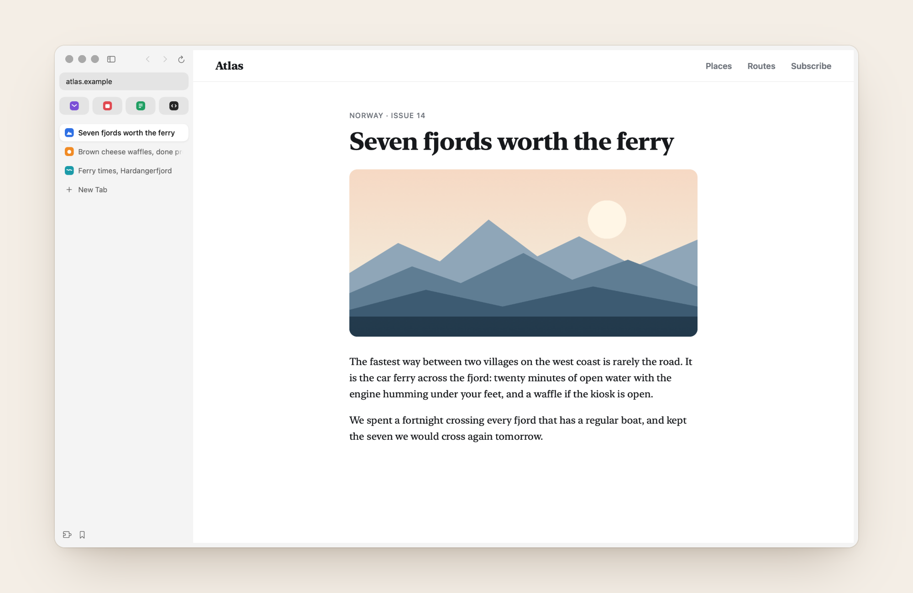
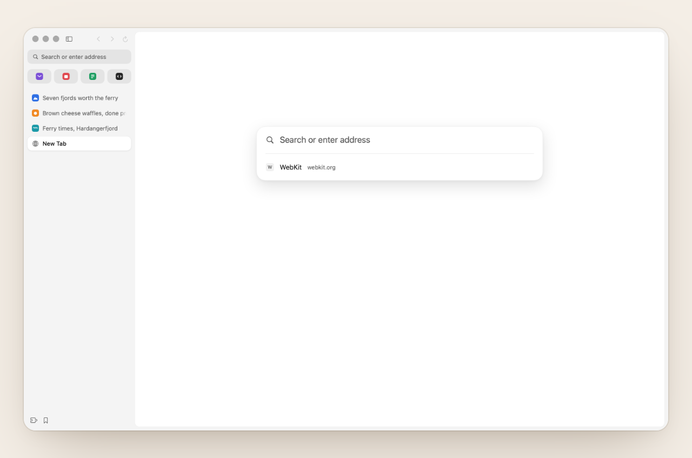
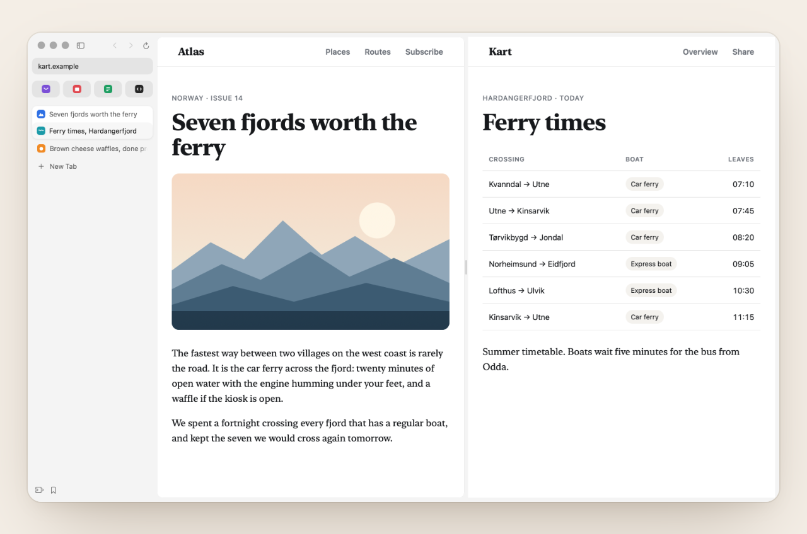
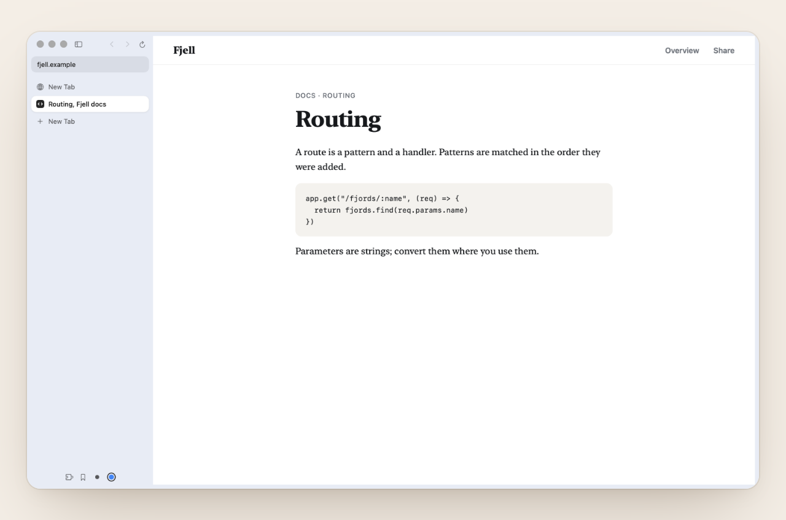
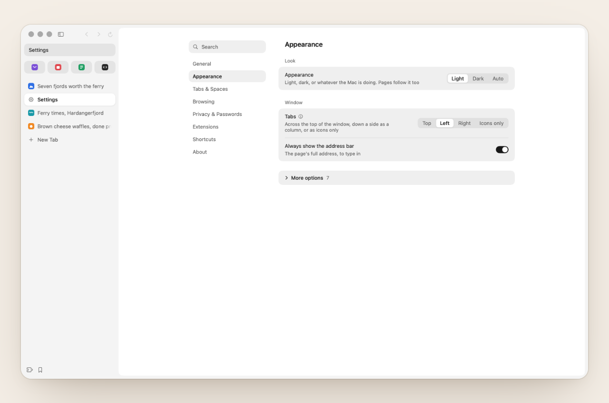
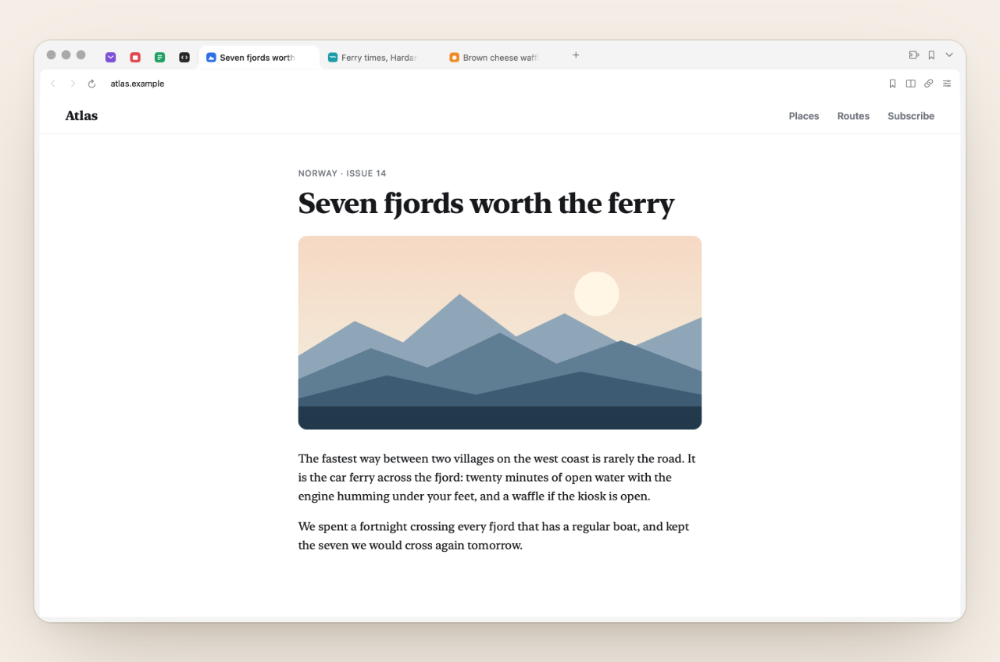

  <picture>
    <source media="(prefers-color-scheme: dark)" srcset="docs/images/wordmark-dark.svg">
    
  </picture>

  <strong>A small, fast, quiet browser for the Mac.</strong> 
  <em>Lun</em> is Norwegian for warm and sheltered.

  <a href="https://github.com/petterblaasmo/lun/releases/latest"><strong>Download for Mac</strong></a>
  &nbsp;·&nbsp;
  <a href="#building-it">Build it yourself</a>
  &nbsp;·&nbsp;
  <a href="https://github.com/petterblaasmo/lun/issues/new/choose">Say what you find</a>

Apple silicon · macOS 14 or later · version 0.1.2 · MIT

  <picture>
    <source media="(prefers-color-scheme: dark)" srcset="docs/images/hero-dark.png">
    
  </picture>

## The tabs, and the page

That is all there is on screen. Lun runs on WebKit, the engine already in every Mac, so it stays small (an 8 MB download) and opens fast. There is no account to make and no telemetry.

<table>
  <tr>
    <td width="50%" valign="top">
      <picture>
        <source media="(prefers-color-scheme: dark)" srcset="docs/images/newtab-dark.png">
        
      </picture>
      
<strong>A new tab is one card.</strong> Type an address or a search, or pick up where you were. Nothing else asks for your attention.

    </td>
    <td width="50%" valign="top">
      <picture>
        <source media="(prefers-color-scheme: dark)" srcset="docs/images/split-dark.png">
        
      </picture>
      
<strong>Two pages, side by side.</strong> Split View keeps an article beside the timetable it talks about. ⌥-click a tab, or drag one onto the page.

    </td>
  </tr>
  <tr>
    <td width="50%" valign="top">
      <picture>
        <source media="(prefers-color-scheme: dark)" srcset="docs/images/space-dark.png">
        
      </picture>
      
<strong>Spaces keep things apart.</strong> Work in one, the trip in another, each with its own tabs, pins and colour. Swipe between them.

    </td>
    <td width="50%" valign="top">
      <picture>
        <source media="(prefers-color-scheme: dark)" srcset="docs/images/settings-dark.png">
        
      </picture>
      
<strong>Settings you can read in a minute.</strong> Each page opens on the few rows most people come for. The rest is one press away, and there is not much of it.

    </td>
  </tr>
  <tr>
    <td width="50%" valign="top">
      <picture>
        <source media="(prefers-color-scheme: dark)" srcset="docs/images/top-dark.png">
        
      </picture>
      
<strong>Tabs where you want them.</strong> Down the left, down the right, across the top, or as a narrow strip of icons. ⌘S puts them away.

    </td>
    <td width="50%" valign="top">
      
<strong>And the rest</strong>

      <ul>
        <li>Pinned sites and pinned rows, in folders if you like</li>
        <li>A built-in ad and tracker blocker</li>
        <li>Reading mode, and a video that floats when you leave its tab</li>
        <li>Peek at a link without leaving the page</li>
        <li>Passwords in the macOS keychain, behind Touch ID</li>
        <li>Chrome extensions, on WebKit's own extension engine (macOS 15.4 or later)</li>
        <li>Bring your tabs, bookmarks, history and passwords over from Arc, Chrome, Firefox and others</li>
        <li>Tabs you leave alone go to sleep, and can close themselves</li>
        <li>Light and dark, following the Mac</li>
      </ul>
    </td>
  </tr>
</table>

## Download

Get `Lun.dmg` from the [newest release](https://github.com/petterblaasmo/lun/releases/latest), open it, and drag Lun to Applications. It is signed and notarised, and keeps itself up to date from there.

It is early: version 0.1.2. Expect rough edges, and [say what you find](https://github.com/petterblaasmo/lun/issues/new/choose).

## A few keys

| | |
|---|---|
| `⌘T` | New tab |
| `⌘L` | The address |
| `⌘S` | Hide or show the tabs |
| `⌘K` | Search your open tabs |
| `⌃Tab` | The tab you were on before |
| `⌥⌘N` | Split View |
| `⌃⇧↑` `⌃⇧↓` | Move the tab up or down |
| `⇧⌘R` | Reload from the network |
| `⌥⌘R` | Reading mode |

Every key can be changed in Settings › Shortcuts.

## Not yet

| | Needs |
|---|---|
| Intel Macs | A second build; for now, build it yourself |
| Passkeys and iCloud sync | An Apple provisioning profile ([#130](https://github.com/petterblaasmo/lun/issues/130)) |

## Building it

macOS 14 or later, and Xcode with Swift 6.

| | |
|---|---|
| `swift build` | Debug build |
| `./build.sh` | A double-clickable app in `build/` |
| `SEARCH_DEV=1 ./build.sh` | The same with a yellow icon, named for the branch |
| `./fresh.sh` | Opens the app in a test world, apart from your own data |
| `swift test` | Unit tests |
| `./bench` | Drives a running app from the shell |
| `./release.sh --try` | The release files, unnotarised, nothing uploaded |

A build of your own is signed ad hoc, so passkeys and iCloud sync stay off.

## Where your data is

| What | Where |
|---|---|
| Passwords | The macOS keychain, tagged `Lun` |
| History, bookmarks, tabs | `~/Library/Application Support/Lun/` |
| Cookies and site data | WebKit's store for the app |

Lun has no server of its own: no account, no telemetry, and no sync. By itself it only checks this repository's releases for a newer Lun, and the Chrome Web Store for newer versions of the extensions you installed.

## Contributing

Bugs, ideas and pull requests are welcome: see [CONTRIBUTING.md](CONTRIBUTING.md). For a security problem, see [SECURITY.md](SECURITY.md) instead of opening an issue.

## License

MIT, see [LICENSE](LICENSE). Third-party parts are in [THIRD_PARTY_NOTICES.md](THIRD_PARTY_NOTICES.md).
